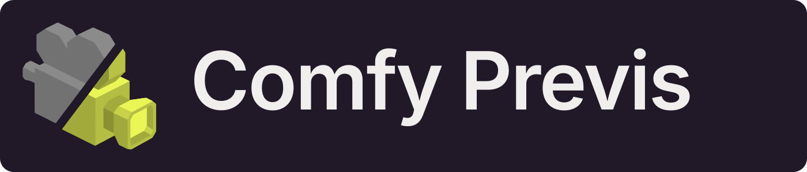
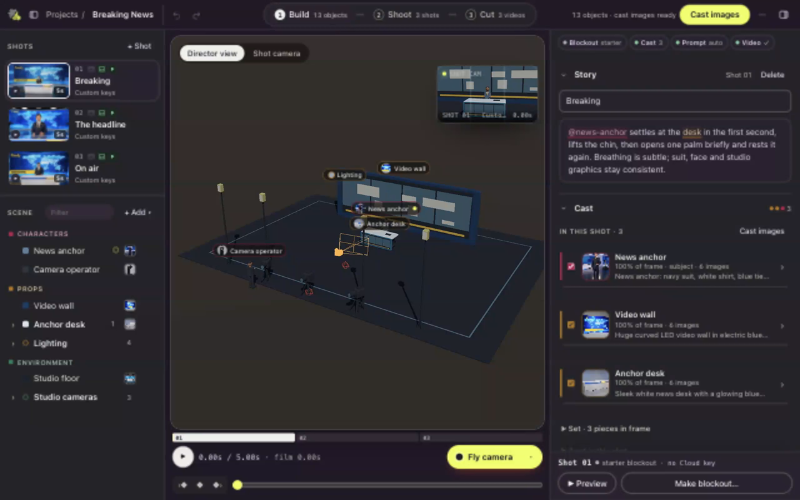
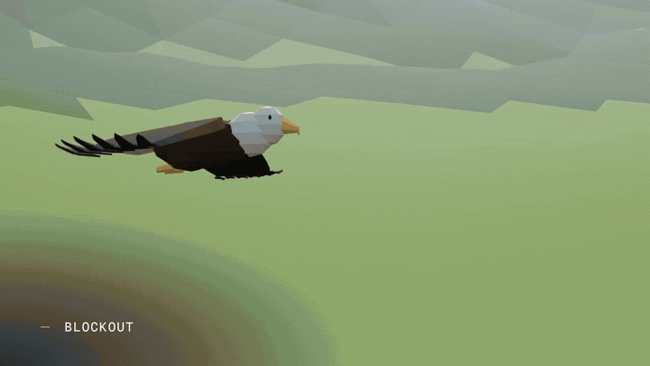
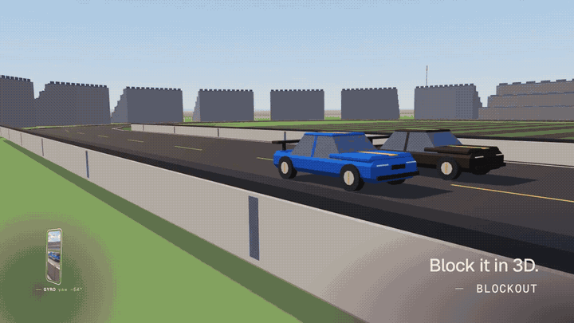
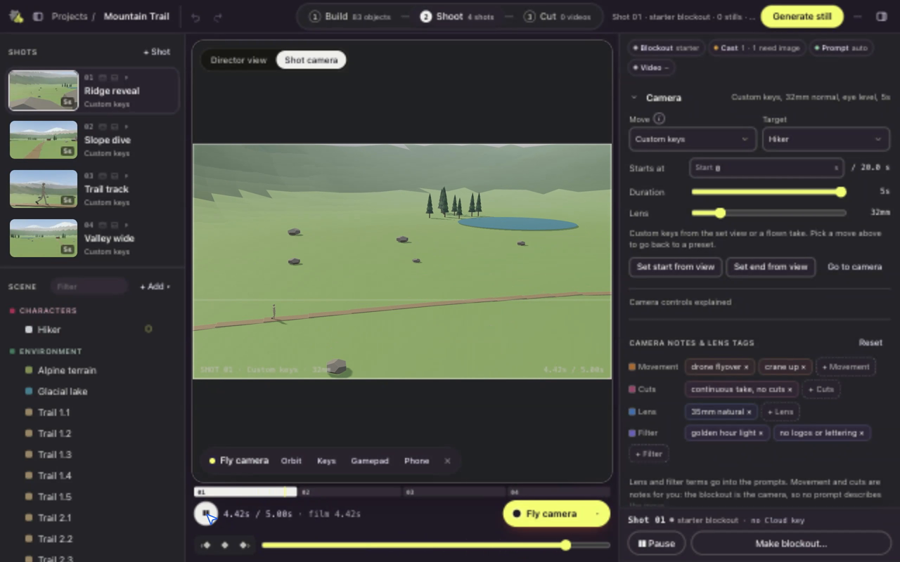
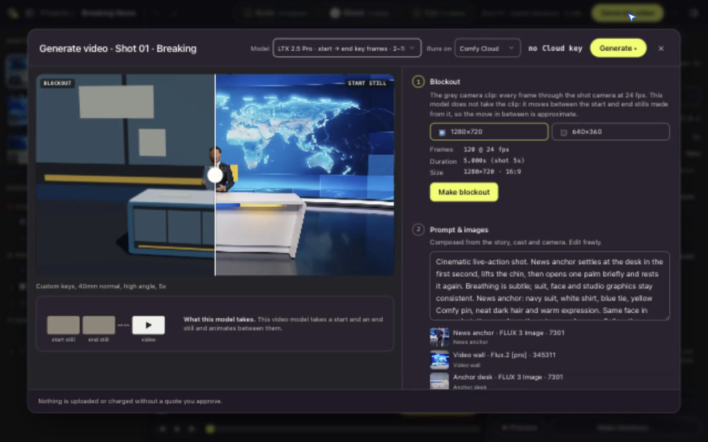

<p align="center">
  
</p>

# Comfy Previs

**Direct AI video in 3D.**

AI video takes a prompt. Comfy Previs takes direction. Block out a scene, cast your characters, frame the camera and turn your shots into storyboard stills and AI video. Open source, MIT licensed, and built on [ComfyUI](https://github.com/comfyanonymous/ComfyUI).

[**Try the live demo**](https://sbobyn.github.io/comfy-three-previs/) · [**Watch the launch film**](https://github.com/sbobyn/comfy-three-previs/releases/download/films/launch-film.mp4) · [**Get started**](#quick-start) · [**Read the guide**](docs/director.md)

The demo is read-only: explore the scenes and watch their existing media. Install locally to edit and generate.

[](https://sbobyn.github.io/comfy-three-previs/)

### Your blockout becomes the shot



### Preview your camera move



| Preview the camera | Inspect generation inputs |
| --- | --- |
|  |  |

## From blockout to finished shot

**Build → Cast → Shoot → Generate → Cut.**

- **Direct in 3D.** Place, group and keyframe people, props and sets. Choose a camera preset or set your own camera keys. Record a handheld take with your phone's gyro, or fly the camera with a keyboard or gamepad.
- **Bring your own scene.** Import 3D models, including rigged characters, or bring a shot from Blender with its camera, animated objects and rendered blockout frames. [Model import](docs/import.md) · [Blender import](docs/blender-import.md)
- **See where the prompt comes from.** Auto-prompt identifies what is in the shot from the scene and camera. Colour-coded words link back to objects in the viewport. Inspect the exact prompt sent to each model, see each section's source, and override or lock sections per shot.
- **Try the still before the video.** Make a storyboard frame for a few cents, then compare takes. Cast Cards keep descriptions, reference images and design sheets together to help characters and props stay consistent across shots.
- **Change one thing at a time.** Look presets cover time of day, weather, season, lighting, wardrobe and art style. Make variants of one shot with the same blocking and camera; inspect the world and look sections before generating. [Look presets and variants](docs/look-presets.md)
- **Choose your model.** Use the built-in image and video presets on Comfy Cloud, or your own GPU with local ComfyUI. Models take different inputs: the app shows whether a model sees a blockout clip, a start still or start/end stills. [Available models](#models-and-costs)
- **Know the cost before a paid run.** Review the quote, set account and project caps, and track reservations and spend in the ledger. A dry-run batch plans the work without sending anything.
- **Bring your own agent.** The local MCP server exposes scene, cast, camera, prompt and generation tools to MCP clients such as Claude Code and Claude Desktop. Agent edits appear live in the workspace. [Connect an agent](#direct-with-an-agent-mcp)
- **Cut and share.** Sequence shots, choose takes, compare results and export a film, or share an editable project as a portable `.previs.zip`. Film exports currently have no sound.

### Masked edits — fixed region (Cloud)

[Watch a masked edit in the launch film](https://github.com/sbobyn/comfy-three-previs/releases/download/films/launch-film.mp4).

From an eligible video take in the Take lab, **Edit region…** paints a fixed mask, quotes a trusted Cloud estimate, regenerates only that crop (Wan 2.1 VACE 14B on Comfy Cloud), then composites locally so outside-mask pixels stay exact before encode. First shipping limits: silent **1280×720 / 24 fps / 81-frame** takes, one fixed mask (not tracked), no chained edits, and the cut does not switch to the edit unless you mark it. The quote is a historical GPU planning envelope — not a provider bill cap — and needs `PREVIS_ALLOW_PAID=1` plus a Comfy Cloud key. The wardrobe example still landed near **$0.15 versus $1.52** for full regeneration; your crop size and Cloud runtime decide the real charge.

## Quick start

You need **Node.js 22.12+** and **pnpm 10**. FFmpeg is needed to encode blockout videos and export films; `pnpm run doctor` checks your machine.

```sh
git clone --depth 1 --single-branch https://github.com/sbobyn/comfy-three-previs.git
cd comfy-three-previs
corepack enable
pnpm install
pnpm build
pnpm start
```

Open **<http://127.0.0.1:5190>**. Choose a starter or **New scene**, then build and shoot. No API key is needed to explore starters, edit scenes or make local blockouts.

For Comfy Cloud generation, copy the example configuration, edit `.env`, then restart the server:

```sh
cp .env.example .env
```

Set `COMFY_CLOUD_API_KEY` to your own key and `PREVIS_ALLOW_PAID=1` to enable paid work. Set spending caps before generating; the app quotes each run. Keep `.env` private. For your own GPU, configure local ComfyUI in **Setup** (`PREVIS_COMFY_URL`, default `http://127.0.0.1:8000`).

Follow the [first-use walkthrough](docs/first-use.md) for your first shot. Phone control needs local HTTPS and pairing: [phone setup](docs/director-phone.md). See [gamepad controls](docs/gamepad.md) for both game and RC Mode 2 layouts.

## Start with a scene

Open a starter from the home page to make an editable copy. The [starter index](examples/starters/index.json) is the source of truth; [starter notes](examples/starters/README.md) describe the included media and model limitations.

| Starter | Explore |
|---|---|
| **Breaking News** | A news anchor breaks the story of this launch. |
| **Wingspan** | An eagle dives through an alpine valley. |
| **Final Lap** | A race car wins on the last lap. |
| **Posterized** | A dunk in a packed arena. |
| **Mountain Trail** | An open valley for tracking, drone and phone-camera takes. |
| **City Blocks** | Street-level and rooftop camera moves. |
| **Lighthouse · Camera Moves** | A lighthouse headland with every camera preset, custom keys and transitions composed across shot pairs. |
| **Look Lab** | One blockout in thirty-four looks, with stills and selected videos. |
| **Two-Hander** | Seated dialogue coverage, gestures and an insert. |

The first four include generated media and a cut. The blockout starters focus on cameras and scene direction; Look Lab also includes generated looks. If blocking changed after a starter's media was made, it marks that media as older. If media is missing, it opens as a blockout and says so. Cut joins shots with hard cuts; it does not add transition effects.

## Direct with an agent (MCP)

Start the app, then open **⋯ More → Direct with Claude** to copy a command with your actual Node and checkout paths, or a Claude Desktop configuration. For Claude Code, the command is:

```sh
claude mcp add comfy-previs -e PREVIS_URL=http://127.0.0.1:5190 -- node /path/to/comfy-three-previs/server/previs/agent.mjs
```

Replace `/path/to/comfy-three-previs` with your checkout. Other MCP clients can launch the same `node` process with `PREVIS_URL` pointing to the running app.

Try: “Build a two-person conversation in a café. Give me a wide shot, two over-the-shoulders and a close-up. Quote the stills before generating.”

The agent can create projects, edit objects and Cast Cards, set cameras, inspect prompt sections, import Blender shots and quote batches. Tell it your budget: paid tools carry `maxCostUsd` and can execute when the server permits paid work, without another UI confirmation. The server's spending caps still apply. Leave `PREVIS_ALLOW_PAID` off for free editing and quotes.

To make stills and blockouts without the app open in a browser, start the server with `PREVIS_HEADLESS=1`. This needs Google Chrome or Playwright Chromium; set `PREVIS_CHROMIUM` to its executable path on other systems.

## Asset library

Save a reusable object or group with **Save to library** under Appearance, then open **Library → Shared assets → Place** in another project. Its description, style notes, cast images and design sheets travel with it. Saved objects have an `@handle` you can use when directing an agent.

Export a shared asset as `.previs-asset.zip`; drop it on the home page's **Import…** or import it through the Library dialog. Agents can use `previs_library_list`, `previs_library_save`, `previs_library_place`, `previs_library_import` and `previs_library_export`. Storage lives outside individual projects, in `PREVIS_LIBRARY_DIR`, so archiving a project keeps its shared assets. See the [library guide](docs/director.md#library-reuse-objects-across-projects).

## Spending controls

Every paid run reserves its estimate before dispatch. Work that would exceed an account or project cap is refused before it is sent. Estimates include reference images and any paid grader; reservations add a safety margin (10% by default). The Jobs panel shows settled spend and outstanding reservations. Estimates are not a provider-enforced billing limit.

| `.env` setting | Purpose |
|---|---|
| `COMFY_CLOUD_API_KEY` | Your Comfy Cloud key; never commit it. |
| `PREVIS_ALLOW_PAID` | `1` enables paid work; off by default. |
| `PREVIS_BUDGET_CAP_USD` | Account cap in USD, per month by default. Unset means no cap. |
| `PREVIS_BUDGET_PROJECT_CAP_USD` | Cap in USD per project. Unset means no cap. |
| `PREVIS_BUDGET_MARGIN` | Reservation safety margin, default 10%. |
| `PREVIS_COMFY_URL` | Local ComfyUI URL. |
| `PREVIS_DATA_DIR` | Project storage, default `.previs/`. |
| `PREVIS_LIBRARY_DIR` | Shared asset library, default under the data directory. |
| `PORT` | App port, default `5190`. |
| `PREVIS_FFMPEG`, `PREVIS_FFPROBE` | Executable paths when FFmpeg tools are not on `PATH`. |

A batch dry run needs no key and sends no generation requests. With the app running, replace the project ID below with the one from your project URL:

```sh
curl -s -X POST http://127.0.0.1:5190/api/director/batch \
  -H 'content-type: application/json' \
  -d '{"projectId":"<id from the project URL>","steps":["stills","videos"],"tier":"draft","maxCostUsd":0,"dryRun":true}'
```

Agents can use `previs_director_batch_generate` with `dryRun: true`. `pnpm usage:report` reads provider billing; `pnpm usage:settle` compares billed model/time buckets with the ledger. Both need your Cloud key and only read data. The ledger lives in `PREVIS_DATA_DIR/budget/`; uncertain jobs retain reservations because a charge may still arrive.

## Models and costs

Built on ComfyUI, with a choice of Cloud partner models and local workflows. The presets below ship in this branch. Choose the inputs and model that fit your shot: support for one model does not imply that every ComfyUI workflow runs unchanged. Local presets require compatible installed checkpoints and nodes.

These are list-price estimates; review the actual quote, including reference images, before running. The table is generated from the registry with `pnpm docs:models`.

<!-- models:start (generated by scripts/models-table.mjs; do not edit by hand) -->
| Model | Used for | Runs on | Takes | List-price estimate |
|---|---|---|---|---|
| Flux 1.1 [pro] Ultra | Looks, sheets and stills | Comfy Cloud | prompt, blockout frame (stills) | ≈ $0.060 / image |
| FLUX 3 Image (BFL) | Looks, sheets and stills | Comfy Cloud | prompt, up to 9 cast images, blockout frame (stills) | ≈ $0.066 / image |
| Flux.2 [pro] (BFL) | Looks, sheets and stills | Comfy Cloud | prompt, up to 7 cast images, blockout frame (stills) | ≈ $0.028 / image |
| Flux.2 [max] (BFL) | Looks, sheets and stills | Comfy Cloud | prompt, up to 7 cast images, blockout frame (stills) | ≈ $0.071 / image |
| GPT Image 2.5 (OpenAI) | Looks, sheets and stills | Comfy Cloud | prompt, up to 9 cast images, blockout frame (stills) | ≈ $0.076 / image |
| Seedream 5.0 Pro (ByteDance) | Looks, sheets and stills | Comfy Cloud | prompt, up to 9 cast images, blockout frame (stills) | ≈ $0.045 / image |
| Nano Banana Pro (Gemini 3 Pro Image) | Looks, sheets and stills | Comfy Cloud | prompt, up to 9 cast images, blockout frame (stills) | ≈ $0.16 / image |
| Nano Banana 2.1 (Gemini) | Looks, sheets and stills | Comfy Cloud | prompt, up to 9 cast images, blockout frame (stills) | ≈ $0.050 / image |
| Nano Banana 2 (Gemini 3.1 Flash Image) | Looks, sheets and stills | Comfy Cloud | prompt, up to 9 cast images, blockout frame (stills) | ≈ $0.081 / image |
| Local ComfyUI · installed checkpoint | Looks, sheets and stills | Your ComfyUI | prompt, blockout frame (stills) | free (your GPU) |
| LTX 2.5 Pro · start → end key frames | Video from key frames | Comfy Cloud | start key frame, end key frame, prompt | ≈ $0.17 / s |
| LTX 2.5 Pro · animate the key frame | Video from key frames | Comfy Cloud | start key frame, prompt | ≈ $0.17 / s |
| LTX 2.5 Fast · animate the key frame (draft) | Video from key frames | Comfy Cloud | start key frame, prompt | ≈ $0.13 / s |
| Seedance 2.5 · from the start still (reference) | Video from key frames | Comfy Cloud | start key frame, prompt | ≈ $0.33 / s |
| Seedance 2.5 · start → end stills | Video from key frames | Comfy Cloud | start key frame, end key frame, prompt | ≈ $0.33 / s |
| Kling 4.0 · animate the start still | Video from key frames | Comfy Cloud | start key frame, prompt | ≈ $0.22 / s |
| Kling 4.0 · start → end stills | Video from key frames | Comfy Cloud | start key frame, end key frame, prompt | ≈ $0.22 / s |
| Veo 3.1 · animate the start still | Video from key frames | Comfy Cloud | start key frame, prompt | ≈ $0.20 / s |
| Veo 3.1 · start → end stills | Video from key frames | Comfy Cloud | start key frame, end key frame, prompt | ≈ $0.20 / s |
| MiniMax Hailuo H3 · animate the start still | Video from key frames | Comfy Cloud | start key frame, prompt | ≈ $0.13 / s |
| MiniMax Hailuo H3 · start → end stills | Video from key frames | Comfy Cloud | start key frame, end key frame, prompt | ≈ $0.13 / s |
| Wan 2.7 · animate the start still | Video from key frames | Comfy Cloud | start key frame, prompt | ≈ $0.10 / s |
| Wan 2.7 · start → end stills | Video from key frames | Comfy Cloud | start key frame, end key frame, prompt | ≈ $0.10 / s |
| Seedance 2.5 · edit the complete video | Video from the blockout clip | Comfy Cloud | blockout video, prompt | ≈ $0.40 / s |
| Kling O1 · edit the complete video | Video from the blockout clip | Comfy Cloud | blockout video, prompt | ≈ $0.13 / s |
| Wan VACE 1.3B · edge control alternative | Video from the blockout clip | Your ComfyUI | blockout video (as control frames), prompt | free (your GPU) |
<!-- models:end -->

## Documentation

- [First use](docs/first-use.md) and [full director guide](docs/director.md)
- [Look presets and variants](docs/look-presets.md) and [what needs regenerating](docs/regeneration.md)
- [Bring a shot from Blender](docs/blender-import.md) and [import models and rigged characters](docs/import.md)
- [Phone camera](docs/director-phone.md) and [gamepad controls](docs/gamepad.md)
- [Blockout modelling rules](docs/blockout-modeling-rules.md) and [glossary](docs/glossary.md)
- [Starter projects and their media](examples/starters/README.md)

The in-app **Guide** includes interactive camera examples and before/after comparisons. [Historical engineering notes](docs/history/README.md) may refer to unpublished `.evidence/` files.

## Report a problem

Choose **Report a problem** in the home footer, **Setup**, or the workspace's **⋯ More** menu. This works in the local app and the read-only demo. The dialog shows the sanitized text before you share it. **Copy details** copies that preview; **Open GitHub issue** opens a bounded, prefilled draft on GitHub. Opening the link sends the draft text to GitHub, but does not submit an issue. Nothing is sent automatically.

Diagnostics include the app version/build, browser and screen, theme, current view, project/shot IDs when present, and up to ten recent errors or failed-request method/path/status lines. Request bodies, project content and environment values are not collected. A shared sanitizer removes recognizable keys/tokens, authorization/cookie headers, emails, URL credentials/query strings/fragments, file URLs and home-directory usernames. Redaction is best-effort: review the preview and remove anything else private. Details are bounded to 12,000 characters (with per-field/error limits); GitHub links are at most 7,000 characters and may shorten the diagnostics. Copy details retains the full bounded preview.

An MCP client can call **`previs_report_issue`** with an optional `summary`. It returns sanitized diagnostics and a prefilled URL, without opening a browser or submitting anything. It includes version, OS, Node, the **names only** of configured `PREVIS_*` / `COMFY_*` settings and setup-check statuses (or “app not reachable”). No GitHub token is needed. Without a GitHub account, copy the details into an email or community chat yourself. Bug-report and feature-request templates are also available on the repository's Issues page.

## Development

```sh
pnpm check     # typecheck + browser and server builds
pnpm test      # full Node test suite
```

The browser app is Vite + three.js (`src/`), the server is plain Node (`server/previs/`), and scene logic is shared in `shared/`.

To build the read-only demo locally, run `pnpm run demo:local`. It imports the bundled starters into temporary storage and writes `dist-demo/`, to be served under `/comfy-three-previs/`. Publishing is documented in [the public publish script](scripts/publish-public.sh); [film publishing](scripts/publish-films.sh) keeps the launch-film release URLs stable. The demo and films are release assets, rather than build outputs committed to the repo.

## License and credits

[MIT](LICENSE) · Copyright © 2026 Steven Bobyn.

Built on [ComfyUI](https://github.com/comfyanonymous/ComfyUI), with three.js, Vite and Node. Third-party components and their licenses are listed in [THIRD_PARTY_NOTICES.md](THIRD_PARTY_NOTICES.md) and [third-party-licenses/](third-party-licenses/). Imported assets and model services have their own licenses and terms.
