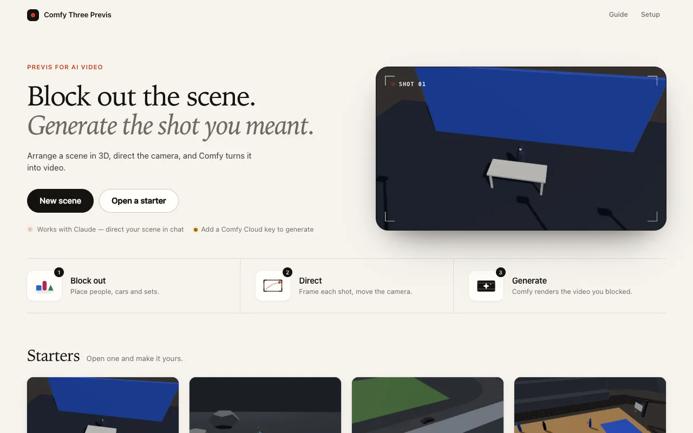
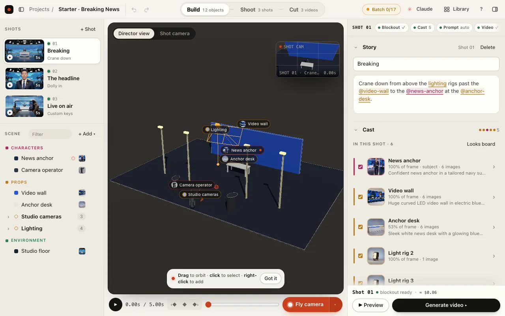
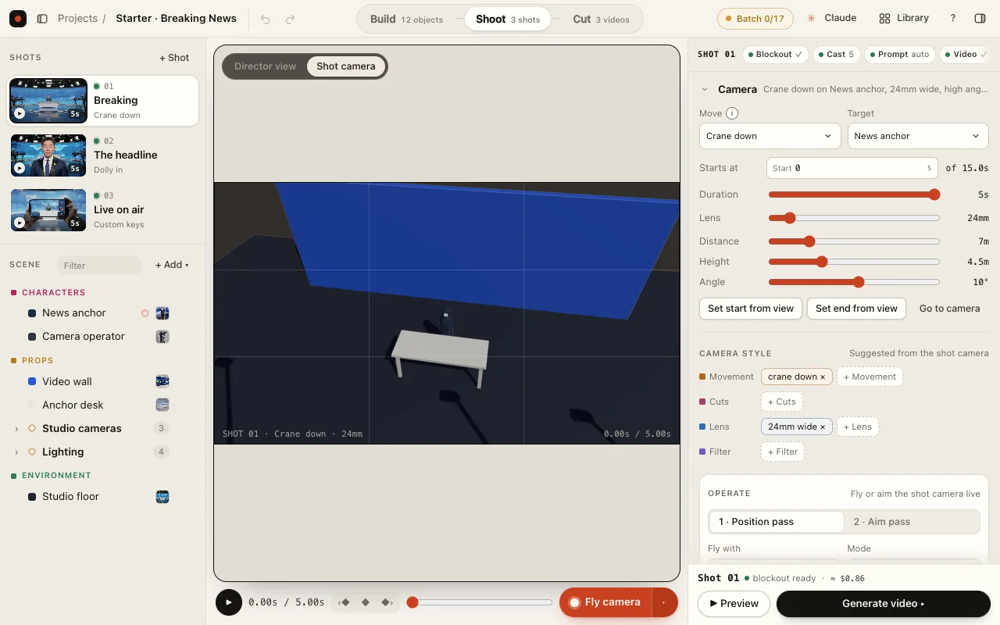
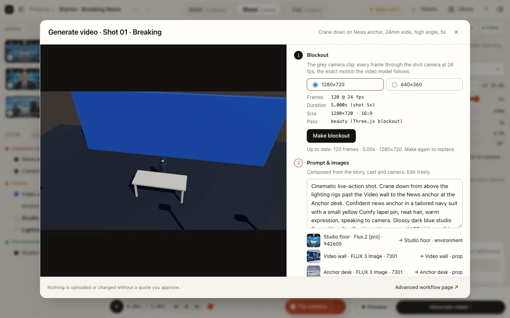
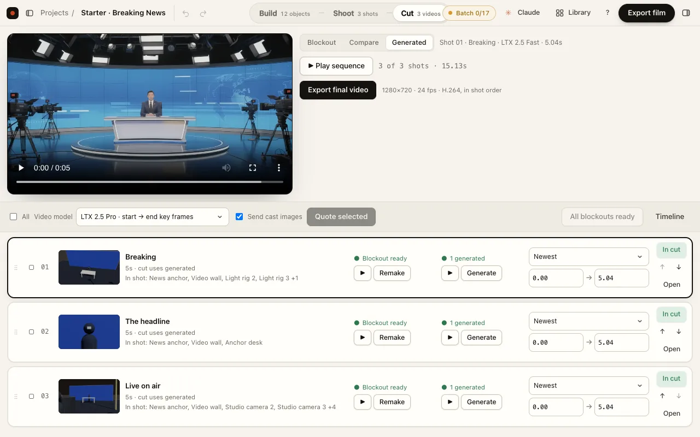

# Comfy Three Previs guide

Build → Cast → Shoot → Generate → Cut. Open a starter on the home page to explore a finished example (cast images, design sheets, stills, a video per shot and a cut, all already made), or create an empty scene. The in-app **Guide** has interactive examples; opening it never edits a project or starts a generation.

## 1. Build

Block out the people, vehicles, props and set with simple 3D objects.

- Right-click or press **Shift + A** to add an object, then name it.
- Drag empty space to orbit, right-drag to pan and scroll to zoom. Click selects; Shift-click adds to the selection; Shift-drag draws a selection box.
- **G / R / S** move, rotate and resize. **X / Y / Z** constrain an axis; type a number and press Enter to confirm. Escape cancels.
- **Ctrl/⌘ + G** groups selected objects. Click again inside a selected group to edit a piece.
- Press **I** to set a key at the playhead, move later in the shot, move the object and set another key. Preview to see the motion.

## 2. Cast

Give objects cast images so their appearance carries between shots.

- Open an object and upload or drop an image, or request an image from its description.
- A design sheet shows the same design from several views. Pick the image you want to use for the object.
- The app gathers cast images for objects visible in the shot. Review the actual inputs before approving a request: models accept different inputs and counts.
- Make a still to check the shot's composition and appearance before making a video.

The in-app guide compares the grey blockout with this Breaking News still and shows the cast images used.

## 3. Shoot

Pick a shot, frame its subject and preview the camera move.

- Set **distance, height, angle and lens**, then choose a move. The information button beside Move previews it.
- **Preview** plays the shot. **C** looks through the shot camera.
- **Fly camera** records a take using the keyboard, gamepad or phone. Keep the take to use it as camera keys.
- Keyboard flight: W/S forward/back, A/D sideways, Q/E turn, Space/Shift up/down, arrows aim, Alt slows, R records and Escape releases.

See [device controls](device-controls.md) for gamepad layouts and [phone setup](director-phone.md) for pairing over local HTTPS. The guide includes keyboard, gamepad and phone diagrams.

## 4. Generate

Make the grey blockout, then ask a video model to turn it into the shot.

- **Make blockout** captures the shot camera on your computer for free. If you change the shot, make the blockout again.
- Choose a video model. Some models follow a clip; others animate from one or two stills and do not see the full camera move.
- Review the inputs, where the model runs and the estimated cost. Paid work needs explicit approval; opening the guide never approves anything.
- Inspect the result against the blockout. A still is typically a few cents and a five-second video about a dollar, but the estimate for your selected model is the one to check.

[Watch the blockout](../public/guide/final-lap-s2-blockout.mp4) · [Watch the generated shot](../public/guide/final-lap-s2-generated.mp4)

### Models

List prices are Comfy Cloud estimates from each node's live price badge (checked 2026-10-30). The app quotes every request before you approve it; reference-image surcharges and Cloud overhead are not included.

**Video** (start-still models animate the shot's Start still; start → end models also pin its End still, and without one fall back to the start-only model at the same price):

| Model | Comfy node | Takes | Clip lengths | ≈ List price |
|---|---|---|---|---|
| LTX 2.5 Fast (draft) | `LtxApi25ImageToVideo` | start still | 2–10 s | $0.13/s (720p) |
| LTX 2.5 Pro | `LtxApi25ImageToVideo` | start, or start → end | 2–10 s | $0.17/s (720p) |
| Seedance 2.5 | `ByteDance2ReferenceNodeV2` (start still as reference image 1; may reframe), `ByteDance2FirstLastFrameNode` | start (as reference), or start → end | 4–10 s | $0.33/s (720p, token-billed) |
| Kling 4.0 | `Kling4ImageToVideoNode` | start, or start → end | 3–10 s | $0.22/s (720p) |
| Veo 3.1 | `Veo3VideoGenerationNode`, `Veo3FirstLastFrameNode` | start, or start → end | 4, 6 or 8 s | $0.20/s (720p, no audio) |
| MiniMax Hailuo H3 | `MinimaxHailuo03FirstLastFrameNode` | start, or start → end | 4–10 s | $0.13/s (768p) |
| Wan 2.7 | `Wan2ImageToVideoApi` | start, or start → end | 2–10 s | $0.10/s (720p) |
| Seedance 2.5 · edit | `ByteDance2ReferenceNodeV2` (edit) | blockout clip | clip length | $0.40/s (720p) |
| Kling O1 · edit | `KlingOmniProEditVideoNode` | blockout clip | 3–10 s | $0.13/s (720p) |
| Wan VACE 1.3B (local) | `WanVaceToVideo` | blockout edges | as set | local GPU |

**Images** (looks, design sheets and stills; "refs" counts cast images besides a still's blockout guide):

| Model | Comfy node | Refs | ≈ List price |
|---|---|---|---|
| Flux.2 [pro] (draft) | `Flux2ImageNode` | 7 | $0.03 |
| Flux.2 [max] | `Flux2ImageNode` | 7 | $0.07 (+ $0.03–0.24 for refs) |
| FLUX 3 | `Flux3ImageNode` | 9 | $0.07 |
| Flux 1.1 [pro] Ultra | `FluxProUltraImageNode` | guide only | $0.06 |
| GPT Image 2.5 (Sunburst, high) | `OpenAIGPTImageNodeV2` | 9 | $0.06–0.08 (+ ≈ $0.015 per ref) |
| Seedream 5.0 Pro | `ByteDanceSeedreamNodeV3` | 9 | $0.045 |
| Nano Banana Pro | `GeminiImage2Node` (refs padded and batched) | 9 | $0.16 |
| Nano Banana 2.1 / 2 | `GeminiNanoBanana2V2` | 9 | $0.05 / $0.08 |
| Local checkpoint | `CheckpointLoaderSimple` | guide only | local GPU |

Batch tiers: **draft** uses Flux.2 [pro] images and LTX 2.5 Fast video; **final** uses FLUX 3 looks and sheets, GPT Image 2.5 stills and MiniMax Hailuo H3 start → end video (set in `shared/tiers.mjs`). A batch sends every shot's stills before design sheets, so videos start as early as possible.

## 5. Cut

Choose the versions, order and timing of the film.

- Drag shot rows to reorder them.
- Choose a version for each shot and trim its in/out times.
- **In cut** includes or leaves out a shot. Compare blockout and generated video by dragging the seam or using the arrow keys.
- Preview the sequence, then **Export film** to write an MP4 in shot order. Project export separately keeps the editable project and its media together.

## Other ways to work

You can direct the same project through Claude using the MCP connector; see the [README setup](../README.md#direct-scenes-from-claude-mcp). Phone aiming requires local HTTPS and a trusted certificate. The public demo is read-only; generation needs a local installation.

## Guide media and maintenance

The shipped examples live in `public/guide/`; `manifest.json` records their source project, shot, asset and capture time. URLs in the app respect the deployment base, including GitHub Pages. See [guide integration and capture](guide-integration.md) for the capture command and the module APIs.

Older review packs and checkpoints are historical engineering notes, not current user instructions. See [the historical document index](history/README.md).
