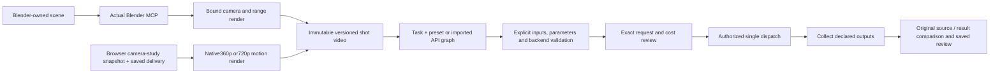
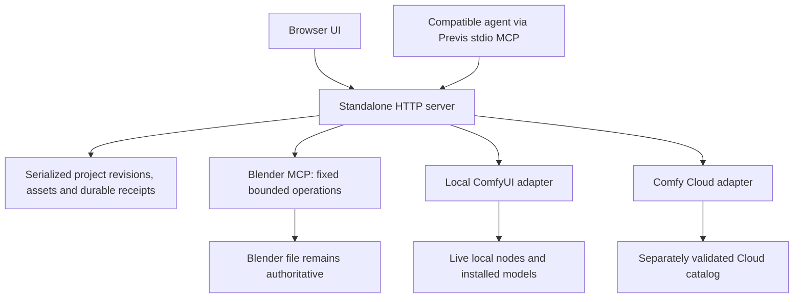

# First-use review checkpoint · 23 October 2026

Standalone Previs is ready for a private workflow review, **not a release-quality local temporal-video claim**. Feature expansion stops here for Steven's feedback. The preserved Kling run is never rerun by these review links. Paid execution remains disabled.

Candidate: `candidate/standalone-previs-first-use-20261023`, extending preserved `candidate/standalone-previs-video-20261022` at `1d08fd0`. The exact integrated SHA, final gates and process ownership are stamped in the local [checkpoint](../.evidence/first-use-20261023/checkpoint.json). Preview: **http://127.0.0.1:5193**. It opens a disposable full-library copy; the original seven assets, three reviews and receipts remain unchanged. Parent and scoped agents used **GPT-6.1 Sol High**. No AI dispatch, provider upload, weights download or billing poll ran tonight.

## Five-minute review route

1. Open the [workspace](http://127.0.0.1:5193/) and choose **Start a three-second dolly**. Replay the unsaved 72-pose sequence. The starting delivery is1280×720,16:9,24fps,3.000seconds; the lightweight option remains640×360. Save a new shot, reopen and check delivery settings. Export renders directly at the selected resolution. [Clean setup and the three starting routes](first-use.md) work without private media or Blender.
2. Open [tonight's exact browser capture](http://127.0.0.1:5193/generation.html?shot=de791bb0-2584-4b1d-9214-25527a0cb7bb&asset=3f51c51b-c1ab-4b31-bdf4-54ac572f7447). Asset `3f51c51b-c1ab-4b31-bdf4-54ac572f7447`, SHA256 `5792147916d0fb9cbc3ac835f7041d03ae7971c93b44b96ba405e7dce0e40bac`, is72frames/24fps/3s/silent1280×720. It took **1.1seconds** to render/upload locally/encode on this Chrome/Mac, not a portable performance guarantee. First/middle/last native PNGs and actual playback show steady knot framing and changing landmark parallax. Metadata alone did not establish this finding. [Native motion samples](../.evidence/first-use-20261023/browser-native-motion-contact.png) are shown at50%; original720pPNGs are retained.
3. Choose Task / Workflow / Backend separately. Tonight's Kling request `630ca5a4-7d07-4e86-a1a2-a0c5a1d0ff74` passed live Cloud schema validation and stopped **quoted**, with no upload/dispatch. Its source hash, player, timing and$0.378partner-estimate basis agree. [Prepared evidence](../.evidence/first-use-20261023/browser-kling-prepared-proof.json) and [UI proof](../.evidence/first-use-20261023/browser-kling-prepared.jpg) retain that checkpoint. Loading saved shot settings restores the mapped prompt/parameters; a page reload requires a fresh preparation before any approval. Do not run a new generation for this review.
4. Open the [recorded Kling comparison](http://127.0.0.1:5193/generation.html?job=1c706a23-064a-4dcc-9f4e-2c6ec6ed8a3b). Play, seek to3.02s and inspect the restored review: source ends3.000s while result continues to3.041667s. Original bytes remain downloadable. This is private saved review material, not a bundled clean-install template. No user's project or QA probe is selected as the showcase by title/order.
5. Open the [quality-rejected local AI comparison](http://127.0.0.1:5193/generation.html?job=7f8725a2-88ce-46c2-acfb-71cc0cddf54b). All72frames underwent SD1.5 inference in the earlier run; it remains a framewise test, not temporal qualification. Blender is not needed for any saved comparison. For new Blender work, open your own scene and use the explicit Blender-first route. Camera-only transfer still omits geometry.

[Updated short Chrome walkthrough](../.evidence/first-use-20261023/first-use-walkthrough.mp4) · [720p export screenshot](../.evidence/first-use-20261023/browser-720p-export.jpg) · [earlier complete walkthrough](../.evidence/review-20261022/previs-hands-on-walkthrough.mp4).

Recordings use actual Chrome screenshot frames encoded locally, with idle gaps shortened. They are edited UI demonstrations, not export/inference benchmarks. T3 snapshot timed out twice again, so Chrome was used. The source clips/results remain unedited. Tonight did not perform Blender or AI inference. The prior scene file may be absent or Blender closed; saved media remains available and reconnect instructions explain how to resume live work.

## Workflow and architecture

Blender-only works with existing scenes; browser-only requires no Blender; combined currently transfers **camera only** into a new named Blender scene at 24 fps. Geometry/assets are omitted, no source scene is overwritten, and no lossless round trip is claimed. Neither route requires Otter. Held Otter work remains untouched; future consumers use independently agreed file contracts.

## Qualification and starter inventory

| Workflow / capability | Schema | Real execution | Visual review / limit |
| --- | --- | --- | --- |
| Kling O1, full beauty-video edit, Cloud | Live compatible | One previously approved AI job | Amber appearance and broad camera/parallax follow; geometry changes; 73 vs 72 frames. Review saved. |
| Imported SD1.5 framewise video, local | Live compatible | One real AI job, all 72 input frames | **Quality rejected:** blue remains, geometry/reflections vary. Not a temporal video model or first-frame-only substitution. |
| Imported native video inversion, local | Live compatible | Native processing | Reviewed; transport/collection proof, not AI. |
| Wan VACE 1.3B edge control | Cloud compatible; local missing 3 weights | None | No speed, quality or hardware qualification. Timing/framing disclosure follows actual settings. |
| Imported LoRA chains | Preserved and prepared; missing filenames reported | No LoRA inference | Configuration/edit/reload proof only; no insertion or model substitution. |
| Blender beauty animation / browser motion export | Bounded contracts | Earlier Blender captures; tonight native720p browser render and playback | Saved delivery,72-frame timing, exact source and revision persist. Depth/pose passes deferred. |

Shipped authoring content: one browser set (movable blue torus knot, ground, pillars/landmarks), with Locked off, Pilot, straight dolly, arc dolly and crane choices. These are five camera modes in one set. The new three-second dolly/crane sequences fit the export limit. Longer12–16-second controller-study paths remain available; record a shorter take for export. The sphere/ring Blender demo exists locally; it is not a shipped template picker. Built-in AI definitions are Kling and VACE; there is no built-in first-frame preset. Browser720p captures satisfy Kling's declared dimensions;360p remains a lightweight option that does not satisfy its minimum height. Phone/gamepad code is not hardware qualification.

## Local AI evidence and remaining dependency gap

Request `7f8725a2-88ce-46c2-acfb-71cc0cddf54b`, revision 22, uses the unchanged imported graph and existing `v1-5-pruned-emaonly.safetensors`: all source frames → bilinear 512×288 → VAE encode → SD1.5, seed 42, 8 Euler steps, CFG 5, denoise 0.5 → decode → source FPS → H.264. No LoRA. Output `4dd331b4-7e5c-401f-80e4-66c9c36f7e36` is 72 frames, 24 fps, exactly 3 seconds, silent. Backend execution took **88.153 s**. Queue checked idle immediately before the single submission; ownership released after completion. No service changes or downloads.

Comfy Desktop 0.38.0 used MPS/PyTorch 2.10.0.dev20250919 on 128 GiB unified memory. System-reported free memory was 62.01 GiB before dispatch and reached 24.83 GiB in periodic samples. These are system-wide observations, not isolated model memory or a guaranteed peak. Native API fee quote was $0; hardware/electricity costs were not priced.

The installed inventory contains SD1.5 and Qwen image/edit weights, not a suitable temporal video model. The [official VACE route](https://docs.comfy.org/tutorials/video/wan/vace) needs these missing files; read-only [Comfy-Org repository metadata](https://huggingface.co/Comfy-Org/Wan_2.1_ComfyUI_repackaged/tree/main/split_files) reports:

| Missing dependency | Bytes | Destination under models |
| --- | ---: | --- |
| `wan2.1_vace_1.3B_fp16.safetensors` | 4,309,519,800 | `diffusion_models/` |
| `umt5_xxl_fp8_e4m3fn_scaled.safetensors` | 6,735,906,897 | `text_encoders/` |
| `wan_2.1_vae.safetensors` | 253,815,318 | `vae/` |

Total **11.30 GB / 10.52 GiB**, plus working outputs and possible download/cache duplication. Runtime, MPS support and peak memory for this exact graph remain unmeasured; weights alone are not a RAM estimate. No download is authorized. A genuine temporal control-video test remains a release blocker. The [bounded49-frame proposal](local-temporal-test.md) provides exact graph/node/files, Mac uncertainties,~25GBworking/cache budget, operator stop conditions and separate approval requirements. Only read-only live schema/system checks ran tonight; the proposal reports exactly three missing weights.

## Kling billing and Cloud support

Exact Cloud job `142cda51-53a3-4309-9cbe-9682ab582879` matches saved request `1c706a23-064a-4dcc-9f4e-2c6ec6ed8a3b` and graph hash. Provider completion: 18:41:51.987 UTC; app collection: 18:42:25.339 UTC.

| Amount | Meaning |
| --- | --- |
| $0.378 | Published partner estimate for the original three-second input |
| $1 | Local one-request approval allowance; consumed, not a provider-enforced cap |
| $0.378 Kling + $0.041933890985 GPU ≈ **$0.419934** | Reported billed workspace usage in the 18:00–19:00 UTC execution bucket |
| **Unknown** | Exact final settled charge attributable to this job, including adjustments |

Read-only billing checks at 19:19–19:21 UTC returned nonempty invoice-derived workspace usage. The rows have **no job/request ID or settlement status**. Both v1/v2 job records omit charges. A job-linked ledger or provider billing confirmation must establish attribution/finality; neither estimates, reservations nor balance changes settle this gap. [Official billing semantics](https://docs.comfy.org/api-reference/cloud/billing/get-workspace-usage-over-time).

Temporary support decision for this private checkpoint: retain the existing v1 adapter. [Official docs](https://docs.comfy.org/development/cloud/overview) keep it available for existing integrations but warn that behavior may change without notice; no shutdown date is stated. The narrowly deprecated history retrieval was replaced by `/api/jobs/{id}` and validated read-only against this exact job. Request-ID/graph checks and credential stripping remain. Full v2 execution migration is deferred, not an externally mandated immediate blocker. Before public beta, assign an owner to recheck support/compatibility and either explicitly accept temporary v1 support or complete a separately scoped v2 migration.

## Distribution, verification and next polish

MIT covers our original code; dependency notices remain. The specific unresolved distribution issue is inherited three-vcam material: 20 baseline commits attributed to `sbobyn`, no tracked baseline license. Authorship metadata is not ownership proof. Steven must confirm ownership of those portions or identify upstream grants. See [third-party notices](../THIRD_PARTY_NOTICES.md). Publication still needs separate approval.

Final gates: `pnpm check`, `pnpm test`, `git diff --check`; clean committed checkout: `pnpm install --offline --frozen-lockfile`. Exact results and SHA are in the linked checkpoint. Tests are simulations except marked real FFmpeg tests; tonight’s real Chrome render/Cloud read-only validation is separate from earlier MCP/Comfy execution evidence. Independent correctness review of51a36ab reported noP1/P2, passed54relevant tests and two additional simulations. Baseline packaging passed72tests onNode25; final minimum-version gates run separately onNode22.23.2. UI and stdio MCP read the same project and job identities. No new paid execution or automatic retries.

Three highest-impact polish candidates, pending hands-on feedback:

1. A simpler shot-centered route between camera studio, render and comparison, with fewer long forms.
2. A calmer camera workbench that separates the main saved-shot transport from advanced controller-study controls, following Steven’s feedback.
3. Compact workflow parameter groups and clearer job progress, keeping full imported graph controls in Advanced.

Remaining release gates: qualified temporal local-video model/result; inherited ownership clearance; public Cloud compatibility/support decision and separate publication authorization. Exact Kling billing attribution remains an accounting follow-up, not a reason to rerun it.
