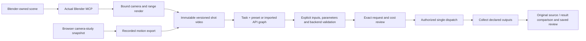
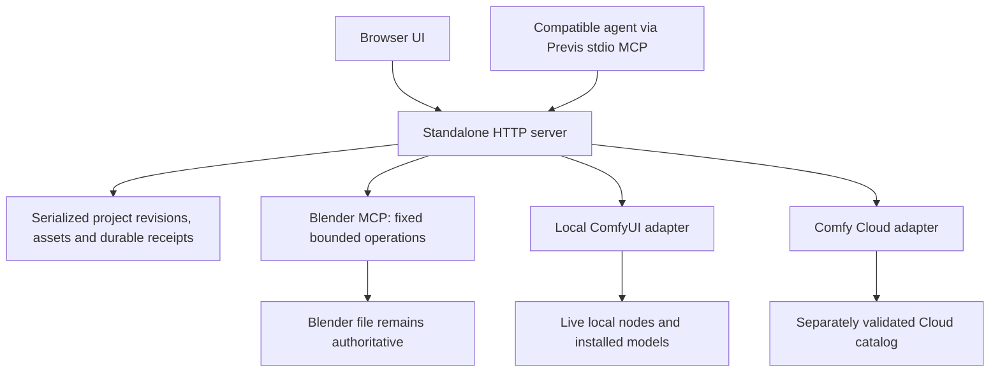

# Hands-on review checkpoint · 22 October 2026

Standalone Previs is ready for a private workflow review, **not a release-quality local temporal-video claim**. Feature expansion stops here for Steven's feedback. The preserved Kling run is never rerun by these review links. Paid execution remains disabled.

Candidate: `candidate/standalone-previs-video-20261022`. Implementation through `87ce898`; the exact integrated SHA and final gate results are stamped in the local [checkpoint](../.evidence/review-20261022/checkpoint.json) after integration. Preview: **http://127.0.0.1:5190**. Keep the complete project directory and receipts together.

## Five-minute review route

1. Open the [saved Kling comparison](http://127.0.0.1:5190/generation.html?job=1c706a23-064a-4dcc-9f4e-2c6ec6ed8a3b). Scroll to Jobs & comparison, play both, and inspect the saved prompt, request settings and review. At 3.02 seconds, the source explicitly ends at 3.000 while the result continues. Downloads preserve original bytes.
2. Open the [local AI comparison](http://127.0.0.1:5190/generation.html?job=7f8725a2-88ce-46c2-acfb-71cc0cddf54b). This is genuine SD1.5 inference on every source frame. Its review explicitly rejects appearance/temporal quality; it is not a temporal video model. Reload to confirm the saved review returns.
3. Open the [new saved browser dolly](http://127.0.0.1:5190/index.html?shot=8869111c-53a4-4181-9529-1fc53fb7e870). Replay and scrub. For a new take, move the subject, operate a camera move for 3–4 seconds, save a new shot, reopen and export. Browser exports are 640×360, 16:9, 24 fps, at most 120 frames; format guides do not change delivery framing.
4. In [Shots & Blender](http://127.0.0.1:5190/), connect/refresh and inspect `Previs Video Study / Study Camera`, 40 mm at inspected frame 1, frames 1–72 at 24 fps. Blender remains authoritative. A new preview was rendered during this checkpoint; the original three-second video remains version 1. Historical video lenses are honestly labeled unavailable; new animation captures record lenses per frame.
5. In Video workflows, choose Task, Workflow and Backend separately. The saved SD1.5 preset restores the original settings; Advanced exposes mappings and the untouched graph. Inspecting local or Cloud schemas does not submit. Do not click Run for another demonstration.

[52-second real-app walkthrough](../.evidence/review-20261022/previs-hands-on-walkthrough.mp4) · [comparison screenshot](../.evidence/review-20261022/review-ready-cloud-comparison.jpg) · [local paired samples](../.evidence/review-20261022/local-source-result-samples.png).

Recording method: actual Chrome tab screenshot frames encoded locally with FFmpeg; idle gaps shortened. It shows browser direction/save/reopen/replay/export, actual Blender inspection and preview rendering, saved settings and existing local/Cloud comparisons. It is an edited UI recording, not an inference-runtime or playback-performance benchmark. No new paid footage. T3 recording previously timed out twice; native app recording lacked permission. Source and result assets themselves are unedited.

## Workflow and architecture

Blender-only works with existing scenes; browser-only requires no Blender; combined currently transfers **camera only** into a new named Blender scene at 24 fps. Geometry/assets are omitted, no source scene is overwritten, and no lossless round trip is claimed. Neither route requires Otter. Held Otter work remains untouched; future consumers use independently agreed file contracts.

## Qualification and starter inventory

| Workflow / capability | Schema | Real execution | Visual review / limit |
| --- | --- | --- | --- |
| Kling O1, full beauty-video edit, Cloud | Live compatible | One previously approved AI job | Amber appearance and broad camera/parallax follow; geometry changes; 73 vs 72 frames. Review saved. |
| Imported SD1.5 framewise video, local | Live compatible | One real AI job, all 72 input frames | **Quality rejected:** blue remains, geometry/reflections vary. Not a temporal video model or first-frame-only substitution. |
| Imported native video inversion, local | Live compatible | Native processing | Reviewed; transport/collection proof, not AI. |
| Wan VACE 1.3B edge control | Cloud compatible; local missing 3 weights | None | No speed, quality or hardware qualification. Timing/framing disclosure follows actual settings. |
| Imported LoRA chains | Preserved and prepared; missing filenames reported | No LoRA inference | Configuration/edit/reload proof only; no insertion or model substitution. |
| Blender beauty animation / browser motion export | Bounded contracts | Real media captures | Original timing/provenance retained. Depth/pose passes deferred. |

Shipped authoring content: one browser set (movable blue torus knot, ground, pillars/landmarks), with Locked off, Pilot, straight dolly, arc dolly and crane choices. These are five camera modes in one set. Default 12–16-second paths exceed the five-second export limit: record a short segment. The sphere/ring Blender demo exists locally; it is not a shipped template picker. Built-in AI definitions are Kling and VACE; there is no built-in first-frame preset. Browser 360p exports do not satisfy Kling's declared 720-pixel minimum height. Phone/gamepad code is not hardware qualification.

## Local AI evidence and remaining dependency gap

Request `7f8725a2-88ce-46c2-acfb-71cc0cddf54b`, revision 22, uses the unchanged imported graph and existing `v1-5-pruned-emaonly.safetensors`: all source frames → bilinear 512×288 → VAE encode → SD1.5, seed 42, 8 Euler steps, CFG 5, denoise 0.5 → decode → source FPS → H.264. No LoRA. Output `4dd331b4-7e5c-401f-80e4-66c9c36f7e36` is 72 frames, 24 fps, exactly 3 seconds, silent. Backend execution took **88.153 s**. Queue checked idle immediately before the single submission; ownership released after completion. No service changes or downloads.

Comfy Desktop 0.38.0 used MPS/PyTorch 2.10.0.dev20250919 on 128 GiB unified memory. System-reported free memory was 62.01 GiB before dispatch and reached 24.83 GiB in periodic samples. These are system-wide observations, not isolated model memory or a guaranteed peak. Native API fee quote was $0; hardware/electricity costs were not priced.

The installed inventory contains SD1.5 and Qwen image/edit weights, not a suitable temporal video model. The [official VACE route](https://docs.comfy.org/tutorials/video/wan/vace) needs these missing files; read-only [Comfy-Org repository metadata](https://huggingface.co/Comfy-Org/Wan_2.1_ComfyUI_repackaged/tree/main/split_files) reports:

| Missing dependency | Bytes | Destination under models |
| --- | ---: | --- |
| `wan2.1_vace_1.3B_fp16.safetensors` | 4,309,519,800 | `diffusion_models/` |
| `umt5_xxl_fp8_e4m3fn_scaled.safetensors` | 6,735,906,897 | `text_encoders/` |
| `wan_2.1_vae.safetensors` | 253,815,318 | `vae/` |

Total **11.30 GB / 10.52 GiB**, plus working outputs and possible download/cache duplication. Runtime, MPS support and peak memory for this exact graph remain unmeasured; weights alone are not a RAM estimate. No download is authorized. A genuine temporal control-video test remains a release blocker.

## Kling billing and Cloud support

Exact Cloud job `142cda51-53a3-4309-9cbe-9682ab582879` matches saved request `1c706a23-064a-4dcc-9f4e-2c6ec6ed8a3b` and graph hash. Provider completion: 18:41:51.987 UTC; app collection: 18:42:25.339 UTC.

| Amount | Meaning |
| --- | --- |
| $0.378 | Published partner estimate for the original three-second input |
| $1 | Local one-request approval allowance; consumed, not a provider-enforced cap |
| $0.378 Kling + $0.041933890985 GPU ≈ **$0.419934** | Reported billed workspace usage in the 18:00–19:00 UTC execution bucket |
| **Unknown** | Exact final settled charge attributable to this job, including adjustments |

Read-only billing checks at 19:19–19:21 UTC returned nonempty invoice-derived workspace usage. The rows have **no job/request ID or settlement status**. Both v1/v2 job records omit charges. A job-linked ledger or provider billing confirmation must establish attribution/finality; neither estimates, reservations nor balance changes settle this gap. [Official billing semantics](https://docs.comfy.org/api-reference/cloud/billing/get-workspace-usage-over-time).

Temporary support decision for this private checkpoint: retain the existing v1 adapter. [Official docs](https://docs.comfy.org/development/cloud/overview) keep it available for existing integrations but warn that behavior may change without notice; no shutdown date is stated. The narrowly deprecated history retrieval was replaced by `/api/jobs/{id}` and validated read-only against this exact job. Request-ID/graph checks and credential stripping remain. Full v2 execution migration is deferred, not an externally mandated immediate blocker. Before public beta, assign an owner to recheck support/compatibility and either explicitly accept temporary v1 support or complete a separately scoped v2 migration.

## Distribution, verification and next polish

MIT covers our original code; dependency notices remain. The specific unresolved distribution issue is inherited three-vcam material: 20 baseline commits attributed to `sbobyn`, no tracked baseline license. Authorship metadata is not ownership proof. Steven must confirm ownership of those portions or identify upstream grants. See [third-party notices](../THIRD_PARTY_NOTICES.md). Publication still needs separate approval.

Final gates: `pnpm check`, `pnpm test`, `git diff --check`; clean committed checkout: `pnpm install --offline --frozen-lockfile`. Exact results and SHA are in the linked checkpoint. Tests are simulations except marked real FFmpeg tests; real Chrome/MCP/Comfy evidence is named separately above. UI and stdio MCP read the same project and job identities. No new paid execution or automatic retries.

Three highest-impact polish candidates, pending hands-on feedback:

1. A simpler shot-centered route between camera studio, render and comparison, with fewer long forms.
2. Short browser move presets and selectable delivery resolution, with framing limits visible before recording.
3. Compact workflow parameter groups and clearer job progress, keeping full imported graph controls in Advanced.

Remaining release gates: qualified temporal local-video model/result; inherited ownership clearance; public Cloud compatibility/support decision and separate publication authorization. Exact Kling billing attribution remains an accounting follow-up, not a reason to rerun it.
