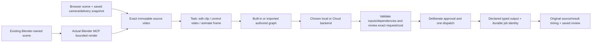

# Tuesday review candidate · 27 October 2026

Prepared privately from reviewed `086f216`, with the original October 22 and 23 candidates and libraries preserved. The current candidate is `candidate/standalone-previs-release-20261027`; exact SHA, verification, asset/request identities and runtime ownership are stamped in [checkpoint.json](../.evidence/release-20261027/checkpoint.json). The new review build uses a disposable full-library copy at **http://127.0.0.1:5197**. The original previews remain separate.

This is a hands-on review build, **not completed local temporal-video qualification**. No paid rerun, provider upload, weight download, automatic retry or publication is included. Saved Kling and rejected SD1.5 results stay unchanged. Parent and scoped reviewers used GPT-6.1 Sol High.

## Five-minute route

1. Open the workspace. **Start a three-second dolly** works without Blender; choose a crane in the same camera-study set if desired. Replay → save a new shot → reopen → export at 1280×720. The saved delivery is 16:9, 24 fps, 72 frames / 3 seconds. Export renders each saved camera pose directly at that resolution. The live workbench pose is restored afterward; it is not a preview of the saved MP4. The export message identifies the immutable capture and its request revision.
2. **Use this exact video in a workflow**. The source picker, player and captured-origin text describe that version, separately from current shot settings. Choose Task / Workflow / Backend; inspect requirements; edit prompt and meaningful parameters; prepare. The prepared source ID/hash, dimensions/timing and estimate basis must agree. Stop before Run. Paid execution stays disabled; no upload occurs during preparation.
3. [Open the recorded Kling comparison](http://127.0.0.1:5197/generation.html?job=1c706a23-064a-4dcc-9f4e-2c6ec6ed8a3b). Its original source is 72 frames / 3 seconds; output is 73 / 3.041667 seconds, both 24 fps. Seek to 3.02 seconds: the source has ended while the result continues. Neither file is fitted. Selected job/output is kept in the URL across full reload. Notes and exact downloads remain tied to that output. Opening a comparison never generates again.
4. [Open the rejected local framewise result](http://127.0.0.1:5197/generation.html?job=7f8725a2-88ce-46c2-acfb-71cc0cddf54b). This is real SD1.5 execution on all 72 frames, with failed appearance/temporal quality; it is not a qualified temporal model. Read the [specific temporal approval proposal](local-temporal-test.md).
5. Blender-first: open and save your existing scene, start the matching MCP addon, then **Connect / refresh Blender**. Choose exact scene/camera/range and save the binding; preview framing, then render video from the workflow page. Previs does not rebuild or save the source scene. With MCP disconnected, saved projects/comparisons/downloads remain usable; live controls explain reconnection. Live Blender rendering was not rerun for this UI checkpoint.

[Tuesday walkthrough](../.evidence/release-20261027/tuesday-walkthrough.mp4) · [Acceptance evidence](../.evidence/release-20261027/acceptance.json). These are operator-local review artifacts, not bundled clean-install media. A clean install starts with the procedural browser set; private example links explain missing media rather than selecting an arbitrary project or QA run.

## Workflow and ownership boundaries

UI and agent MCP use the same project, revision checks, approval fingerprint and uncertain-operation receipts. Missing nodes/models/LoRAs retain exact names. Backend changes invalidate preparation without rewriting the graph. Raw input/output mappings live under Advanced; editable model/LoRA parameters remain visible. Recovery tracks the known identity or explicitly closes an unknown outcome after checks; it never silently resubmits or claims cancellation.

Browser-only authoring requires no Blender. Blender-only binds the author's existing file. Combined remains camera-only transfer to a new Blender scene, with explicit axes/units/lens/FPS limits; geometry is omitted. No lossless round trip, Otter server/account or general scene editor is implied.

Concepts adapted, without copying other applications: Studio's deliberate take selection and saved-versus-live export revisions; Recast's original-versus-derived timing and explicit correction disclosure; typed image/video outputs and source-coordinate versus display/delivery separation. Browser positions remain world coordinates in the immutable snapshot; a CSS preview or framing guide does not change the video dimensions or camera path. No new correction, crop, trim or timing-fit operation was introduced.

## Qualification

| Path | Evidence | Remaining limit |
| --- | --- | --- |
| Browser short dolly/crane → native 720p → prepared Kling request | Real browser export/playback and read-only backend validation; exact IDs in acceptance evidence | No new upload or AI job |
| Existing Blender scene → MCP beauty/video → saved shot | Previously exercised real MCP path; current UI/recovery simulations | Not rerun against a live Blender scene in this checkpoint |
| Kling O1 full-video edit, Cloud | Retained real approved job and saved review | Broad camera/parallax follows; geometry changes; one extra frame |
| Imported SD1.5 framewise video, local | Real all-frame inference; saved rejected review | Quality rejected; no temporal model |
| Native local processing | Real transport/collection | Not AI inference |
| VACE 1.3B local temporal control | Current schemas compatible except three exact missing weights | No model load, inference, Mac runtime or quality qualification |
| Imported LoRA chains | Simulated import/edit/reload/preparation and exact missing-filename errors | No suitable authorized LoRA inference |

The [pinned weight manifest](../examples/wan-vace-local-weights.json) records three Apache-2.0 publisher artifacts totaling **11,299,242,015 bytes**. The proposed single 49-frame, 512×288, 24-fps probe needs separate download/execution approval, about 25 GB free disk, fresh GPU ownership and the documented memory/runtime stop conditions. It omits 23 source frames and cannot qualify the full three-second/720p path. Do not substitute image-only models or silently update the backend if it fails.

## Cost and support

A new three-second Kling O1/720p request may show the published **$0.378 partner estimate**; total Cloud/runtime charges remain unknown. Its fresh receipt is a quote, not dispatch or approval. The original $1 allowance was consumed by the retained run and was not a provider-enforced cap. The previously observed **~$0.419934 workspace usage** bucket has no job ID or settlement status; it is not proven final per-job billing. No repeat aggregate billing poll resolves that gap, so none is required here.

Keep the temporary Cloud v1 support decision and exact-job retrieval checks. Deprecated history retrieval is already replaced. Broader v2 migration is separate unless a concrete blocking failure appears. The current preparation checkpoint is read-only compatibility evidence, not a new execution qualification.

## Private packaging decision

Configured origin remains **`git@github.com:sbobyn/three-vcam.git`**. The proposed destination is a **new private `sbobyn/comfy-previs` repository**, subject to Steven confirming owner/name. No repository was created, remote rewritten, content pushed or visibility changed. Local candidate branches do not constitute publication.

MIT applies to original Previs contributions. Preserve dependency notices and external model/media/workflow rights. Exact inherited-source question: **Are the inherited portions of all 23 baseline paths listed in [THIRD_PARTY_NOTICES.md](../THIRD_PARTY_NOTICES.md) wholly Steven-owned to grant under MIT? If not, identify each upstream source/author and applicable grant.** Git authorship does not settle that issue. This must be resolved before distribution, alongside separate publication approval.

Clean setup uses Node 22.12+ and pnpm 10.18.0, a frozen lockfile and already installed FFmpeg/FFprobe. The [first-use guide](first-use.md) needs no private `.blend`, absolute media path, credential or uncommitted example for browser authoring. Final clean-install verification reuses a populated dependency cache and explicitly reports that limitation; it is not a clean-machine OS installation.

Highest-impact feedback for the next polish pass: camera workbench density, workflow parameter grouping, and the visual emphasis of source-versus-result review. Feature expansion is held for hands-on feedback.
